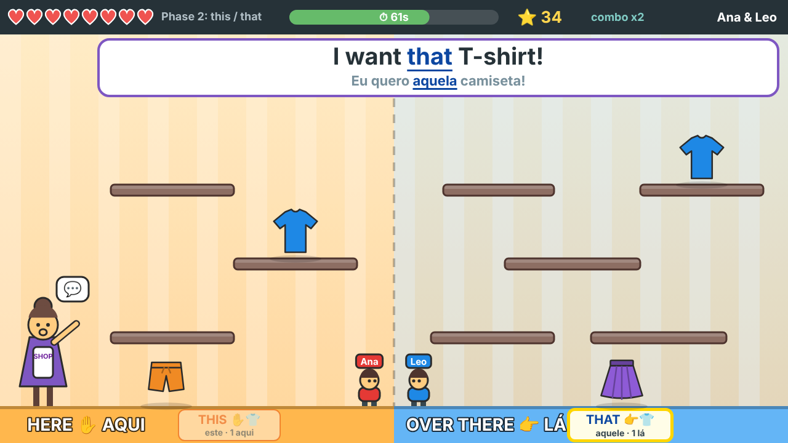
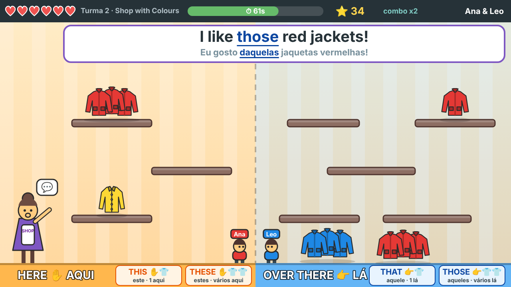
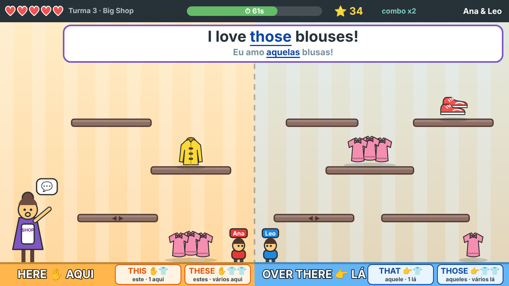

# 👕 Wardrobe Run: Clothes & Demonstratives

Jogo de plataforma cooperativo para praticar vocabulário de inglês (**clothes**) e os **demonstratives** (*this, that, these, those*) com crianças de 6 a 15 anos.

O vocabulário vem das folhas de atividade da aula "Clothes and Demonstratives" das Turmas 1, 2 e 3 (Centro Comunitário Sal da Terra).



## Como funciona

- Uma **vendedora** fica no lado esquerdo da tela e dá ordens: *"Bring me **those** boots!"*. Ela também fala as ordens em voz alta.
- Tudo o que está **perto dela (HERE ✋)** é **this/these**. Tudo o que está **longe (OVER THERE 👉)** é **that/those**.
- Duas crianças jogam **juntas**, no mesmo teclado, pegando a roupa certa. Se pegarem a errada, perdem um coração e o jogo explica o erro.
- Cada dupla joga **90 segundos**. Depois é a vez da **próxima dupla**. Os acertos de todo mundo somam na **meta da turma**.

| Turma | Modo | O que pratica |
|---|---|---|
| 1 | Clothes Shop | Primeiro só as palavras (*Get the hat!*), depois *this/that*, depois os quatro. Dica com desenho. |
| 2 | Shop with Colours | Cores + demonstratives (*I like those red shoes!*) |
| 3 | Question Blocks | Vocabulário completo, plataformas que se mexem e blocos **THIS IS / THESE ARE / THAT'S / THOSE ARE** |

| Turma 2 | Turma 3 |
|---|---|
|  |  |

## Como abrir (sem instalar nada, sem internet)

1. Nesta página do GitHub, clique no botão verde **Code** → **Download ZIP**.
2. Extraia o arquivo ZIP (botão direito → "Extrair tudo").
3. Abra a pasta e dê **dois cliques em `index.html`**. Ele abre no Chrome ou no Edge.

Pronto. O jogo funciona **offline**: dá para baixar em casa e levar para a aula no notebook ou num pen drive.

> Dica: ligue o computador no projetor/TV e aperte **F** no jogo para ficar em tela cheia.

## Controles

| Quem | Teclas |
|---|---|
| Jogador 1 | **A / D** andar · **W** pular · **S** descer da plataforma |
| Jogador 2 | **← / →** andar · **↑** pular · **↓** descer da plataforma |
| Professora | **ENTER** começar / próxima dupla · **ESPAÇO** pausar · **R** repetir a frase · **N** pular a ordem · **M** voz liga/desliga · **F** tela cheia · **ESC** menu |

Controles de videogame USB também funcionam.

## Documentação

- [docs/COMO-USAR.md](docs/COMO-USAR.md): guia passo a passo para a aula (preparação, rodízio de duplas, modo "Say it!").
- [docs/EDITAR-VOCABULARIO.md](docs/EDITAR-VOCABULARIO.md): como adicionar ou trocar palavras.

## Para quem for mexer no código

HTML + CSS + JavaScript puro. Sem frameworks, sem etapa de build, sem dependências. Os scripts são tags `<script>` clássicas (sem ES modules nem `fetch`), então o jogo roda direto pelo `file://`.

```
index.html            menu (turma, jogadores, opções)
game.html             tela do jogo
css/style.css
js/vocabulary.js      vocabulário por turma (editável)
js/sentences.js       todas as frases: ordens, acertos, explicação dos erros
js/clothes-art.js     desenhos das roupas (SVG gerado no código, com troca de cor)
js/levels.js          configuração das turmas e layout das plataformas
js/engine.js          controles (teclado/controle) e física
js/round.js           regras da rodada (ordens, pegadinhas, pontos, corações)
js/draw.js            desenho no canvas
js/audio.js           voz (speechSynthesis) e efeitos sonoros (Web Audio)
js/main.js            loop da tela do jogo e telas sobrepostas
js/menu.js            menu
```

## Licença

MIT. Veja [LICENSE](LICENSE).
